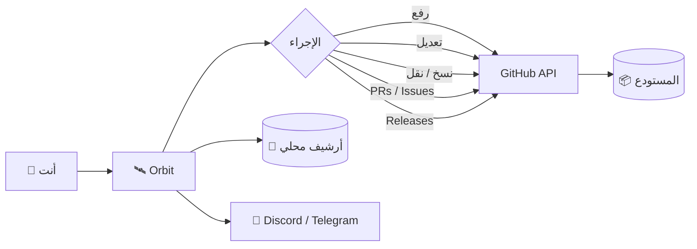

# 🛰️ Orbit

<div align="center">

**ارفع مشروعك كامل إلى GitHub — من المتصفح، بدون سيرفر، بدون مكتبات، بدون تعقيد.**

[](LICENSE)
[](LICENSE)
[](../../releases)
[](#)
[](#)
[](#)

**أداة ويب واحدة. صفر تبعيات. تحكم كامل.**

</div>

---

## 🎨 الهوية البصرية

<div align="center">

| اللون | الكود | الاستخدام |
|:-----:|:-----:|:---------:|
| 🌑 **Midnight** | `#122C4F` | الأسطح المرتفعة |
| 🌊 **Ocean** | `#5B88B2` | اللون الأساسي |
| 🥥 **Pearl** | `#FBF9E4` | النص الأساسي |
| ⬛ **Noir** | `#000000` | الخلفية |

</div>

---

## 🎯 نظرة عامة

**Orbit** أداة ويب مستقلة — ملف `HTML` واحد يعمل في أي متصفح حديث — تتيح لك رفع مشروع كامل إلى **GitHub** مباشرة، مع **تحكم كامل** في الملفات داخل المستودع، **إدارة Pull Requests و Issues و Releases**، **محرر مدمج**، **مسودات محلية**، **إشعارات Webhook**، و**أرشيف كامل** لكل العمليات — بشرط أمان يبقى في يدك.

تعمل الأداة على **GitHub REST API** مباشرة عبر `fetch()` — لا وسطاء، لا سيرفرات، لا جمع بيانات.



---

## ✨ المميزات

### 🔐 المصادقة والأمان

- **التوكن في الذاكرة فقط** — تحقق فوري، قراءة الصلاحيات تلقائيًا، لا يُحفظ في `localStorage` افتراضيًا
- **حفظ اختياري مقيّد** — تفعيل "تذكّر لمدة 30 يومًا" برغبتك الصريحة مع تحذير أمني واضح
- **لا يُرسل لأي جهة** — كل الاتصالات عبر `api.github.com` فقط
- **Rate Limit مباشر** — عرض الحد المتبقي في الهيدر بعد كل استدعاء
- **دعم Fine-grained Tokens** — عرض نوع التوكن تلقائيًا

### 📁 إدارة الملفات

- **اكتشاف تلقائي** — قراءة قائمة المجلد عبر `fetch('./')` حتى عمق 8 مستويات
- **تجاهل تلقائي** — `.git`, `node_modules`, `.cache`, `dist`, `build` وغيرها
- **4 طرق للإضافة** — اختر ملفات / اختر مجلد / سحب وإفلات / مسارات يدوية
- **شجرة تفاعلية** — عرض هرمي مع Checkbox و`indeterminate` للمجلدات
- **رفع ذكي** — تخطي الملفات المتطابقة عبر hash

### 🚀 الرفع إلى GitHub

- **رفع متوازٍ** — 4 ملفات تُرفع في نفس الوقت
- **Base64 + SHA صحيح** — عبر Git Data API
- **إنشاء تلقائي** — للمستودع لو لم يكن موجودًا
- **Progress مباشر** — مع اسم الملف الحالي والحجم والمدة

### 🛠️ أدوات التحكم الكاملة

- **تعديل مباشر** — محرر **CodeMirror 6** بتلوين لغوي لكل اللغات
- **حذف** — بزر واحد مع تأكيد
- **إنشاء** — ملفات جديدة بمسار مخصص (chips تفاعلية)
- **نسخ / نقل** — بين الملفات والمجلدات وحتى **بين المستودعات**
- **إنشاء فروع** — من أي فرع أصلي
- **توليد README تلقائي** — تحليل كامل للمشروع
- **تحميل الفروع** — قائمة كاملة مع تبديل سريع

### 📚 إدارة كاملة من نفس الصفحة

- **Pull Requests** — إنشاء، عرض التفاصيل، دمج، إغلاق
- **Issues** — إنشاء بوصف وتصنيفات، إغلاق، إعادة فتح
- **Releases** — إنشاء بـ tag، pre-release، draft

### 📝 المسودات المحلية

- **حفظ محلي** — قبل الرفع بأي وقت
- **استرجاع سريع** — بنقرة واحدة
- **محتوى نصي أو JSON**

### 🔔 الإشعارات

- **Discord Webhook** — إشعار بعد كل عملية ناجحة
- **Telegram Bot** — تنبيه فوري

### 📚 الأرشيف المحلي

- **سجل كامل** — كل عملية تُسجّل تلقائيًا
- **تفاصيل كاملة** — التاريخ، الملفات، Commit SHA، المدة، الحالة
- **تصدير JSON** — بنقرة واحدة
- **200 عملية** كحد أقصى (الأقدم يُحذف تلقائيًا)

### 🎨 الواجهة

- **باليتة أصيلة** — Midnight · Ocean · Pearl · Noir
- **ثيم فاتح/داكن** — تبديل فوري
- **عربي / English** — ترجمة كاملة مع تبديل مباشر
- **RTL كامل** — للعربية
- **10 تبويبات منظمة** — لا تكديس
- **Responsive** — على كل الشاشات
- **PWA-ready** — يمكن تثبيته كتطبيق
- **اختصارات لوحة مفاتيح** — `Ctrl+K`, `Alt+1-9`, `Ctrl+S`, `Esc`
- **صفر مكتبات CSS/JS خارجية** — عدا CodeMirror (تحميل اختياري)

---

## 🤔 لماذا Orbit؟

<div align="center">

| الحل التقليدي | Orbit |
|:---:|:---:|
| تثبيت Git | ❌ |
| تثبيت Node.js | ❌ |
| تشغيل سيرفر | ❌ |
| مكتبات خارجية | ❌ |
| استخدام Terminal | ❌ |
| تسجيل دخول GitHub | ❌ |
| حفظ أي بيانات عنك | ❌ |
| **يعمل بفتح HTML** | ✅ |

</div>

---

## 📦 التثبيت

### الطريقة 1 — تحميل مباشر

```bash
curl -O https://raw.githubusercontent.com/T7-T7/BOT-STEAM/main/Orbit/orbit.html
```

أو من المتصفح:

<div align="center">

[](../../raw/main/Orbit/orbit.html)

</div>

### الطريقة 2 — استنساخ المستودع

```bash
git clone https://github.com/T7-T7/BOT-STEAM.git
cd BOT-STEAM/Orbit
```

### الطريقة 3 — نسخ يدوي

1. اضغط **Code** → **Download ZIP**
2. فك الضغط في أي مكان
3. افتح `orbit.html` في المتصفح

> [!TIP]
> ### ⚡ للأداء الأفضل
>
> شغّل المشروع على **سيرفر محلي** لتفعيل الاكتشاف التلقائي:
>
> ```bash
> python -m http.server 8000
> # أو
> npx serve
> ```
>
> ثم افتح: `http://localhost:8000/orbit.html`

---

## 🚀 البدء السريع

### 1️⃣ احصل على GitHub Token

افتح [github.com/settings/tokens](https://github.com/settings/tokens) → **Generate new token** → اختر صلاحية `repo` → انسخ التوكن فورًا.

> [!WARNING]
> **لأمان أعلى**: استخدم **Fine-grained Token** مقيّد لمستودع واحد فقط، مع صلاحيات `Contents: RW` + `Administration: RW`، وتاريخ انتهاء قصير.

### 2️⃣ افتح الصفحة

```
📂 Orbit/
├── 📄 orbit.html    ← افتح هذا
└── 📄 README.md
```

### 3️⃣ أدخل التوكن واضغط تحقق

```
┌──────────────────────────────────────────┐
│  🔑  ghp_xxxxxxxxxxxxxxxxxxxxxxxxxxxx    │
│  ─────────────────────────────────────   │
│  ✅  repo · public_repo                  │
└──────────────────────────────────────────┘
```

سيتم تحميل **كل مستودعاتك** تلقائيًا واختيار أول واحد.

### 4️⃣ اختر مستودعًا → 5️⃣ ارفع الملفات → 6️⃣ تحكم بكل شيء 🚀

---

## 📖 التبويبات العشرة

| التبويب | المحتوى |
|:-------:|:--------|
| ⚙️ **الإعداد** | التوكن، الصلاحيات، المستودعات، إنشاء مستودع جديد |
| 📤 **الرفع** | اختيار الملفات، إعداد المسار، شجرة، Progress |
| ⚡ **التحكم** | تحميل المستودع، تعديل، حذف، نسخ، نقل، إنشاء، فروع، توليد README |
| 📝 **المسودات** | مسودات محلية قابلة للاسترجاع |
| 🔀 **الطلبات** | PRs — إنشاء، عرض، دمج، إغلاق |
| ⚠️ **البلاغات** | Issues — إنشاء، إغلاق، إعادة فتح |
| 🏷️ **الإصدارات** | Releases — إنشاء بـ tag، pre-release، draft |
| 📊 **الإحصائيات** | حجم المستودع، اللغات، النجوم، آخر نشاط، إحصائيات محلية |
| 💻 **الأحداث** | السجل المباشر للجلسة |
| 🎛️ **الإعدادات** | ثيم، لغة، أرشيف، إشعارات، مرشد، خصوصية، شروط، FAQ، اختصارات، عن التطبيق |

---

## 🛠️ أدوات التحكم المتقدمة

- **📂 تحميل محتوى المستودع** — شجرة كاملة لكل الملفات مع الفلاتر
- **✏️ تعديل ملف** — محرر CodeMirror 6 بتلوين لكل اللغات
- **🗑️ حذف ملف** — مع تأكيد
- **➕ إنشاء ملف جديد** — بمسار مخصص (chips)
- **📋 نسخ ملف** — إلى أي مستودع أو مجلد
- **📦 نقل ملف** — مع حذف الأصل تلقائيًا
- **🌿 إنشاء فرع** — من أي فرع أصلي
- **📖 توليد README** — تحليل شامل للمشروع + اقتراح محتوى
- **🔀 إنشاء PRs** — بين أي فرعين
- **⚠️ Issues** — مع التصنيفات
- **🏷️ Releases** — مع draft و pre-release

---

## ⌨️ اختصارات لوحة المفاتيح

| الاختصار | الوظيفة |
|:--------:|:--------|
| `Ctrl+K` | فتح / إغلاق الإعدادات |
| `Alt+1-9` | التبديل بين التبويبات |
| `Ctrl+S` | حفظ في المحرر |
| `Ctrl+Enter` | بدء الرفع (في تبويب الرفع) |
| `Esc` | إغلاق النوافذ |

---

## 📚 سجل العمليات

كل عملية تُسجَّل تلقائيًا مع:

| الحقل | الوصف |
|:-----:|:------|
| 🕐 | التاريخ والوقت الكامل |
| 🏷️ | نوع العملية |
| 📦 | قائمة الملفات مع الحجم |
| 🔗 | Commit SHA مع رابط مباشر |
| ⏱️ | المدة بالثواني |
| ✅ | الحالة (نجاح / تحذير / فشل) |

**تصدير** بنقرة واحدة بصيغة JSON، و**مسح** فوري.

---

## 🔒 الأمان

### ⚠️ تحذيرات مهمة

> [!CAUTION]
> **لا تُفعّل "تذكر التوكن" على أجهزة مشتركة**. أي شخص يستخدم نفس الجهاز يمكنه قراءته من DevTools.

> [!IMPORTANT]
> **استخدم Fine-grained Token** بدل `repo` — صلاحيات محددة لمستودع واحد فقط.

> [!TIP]
> **نصائح إضافية**:
> 1. فعّل **2FA** على حسابك
> 2. راجع **Settings → Sessions** شهريًا
> 3. لا تشارك التوكن مع أي شخص
> 4. حدّد تاريخ انتهاء للتوكن

### 🆘 ماذا تفعل عند التسريب؟

1. افتح [github.com/settings/tokens](https://github.com/settings/tokens)
2. **احذف التوكن فورًا**
3. أنشئ توكن جديد
4. راجع Security Logs

---

## 🏗️ البنية التقنية

```
┌─────────────────────────────────────────────┐
│              orbit.html                     │
│          ملف واحد — صفر تبعيات                  │
├─────────────────────────────────────────────┤
│   HTML5 · CSS3 · Vanilla JS (ES2020+)       │
│   Fetch API · DOMParser · LocalStorage      │
│   CodeMirror 6 (اختياري — يُحمَّل عند الحاجة)     │
│   Service Worker · PWA Manifest             │
├─────────────────────────────────────────────┤
│         GitHub REST API v3                  │
│         اتصال مباشر — لا وسطاء                   │
└─────────────────────────────────────────────┘
```

| المكوّن | الوظيفة | التقنية |
|:-------:|:--------|:--------|
| 🎨 الواجهة | عرض + تفاعل | HTML5 + CSS3 Variables |
| 🔐 مدير التوكن | تحقق + حفظ اختياري | GitHub API + localStorage |
| 📁 مستكشف الملفات | اكتشاف + شجرة | `fetch()` + `File System Access API` |
| 🚀 مدير الرفع | Base64 + Blobs | Git Data API + `Promise.all` |
| 🛠️ أدوات التحكم | CRUD على الملفات | Contents API |
| ✏️ المحرر | تلوين لغوي | CodeMirror 6 |
| 🔀 PRs / Issues | إدارة كاملة | REST API v3 |
| 📚 الأرشيف | تتبع العمليات | localStorage |
| 🔔 الإشعارات | Discord / Telegram | Webhook + Bot API |
| 🌐 الترجمة | عربي / English | نظام i18n مدمج |

---

## ❓ الأسئلة الشائعة

<details>
<summary><b>🔍 لماذا الاكت