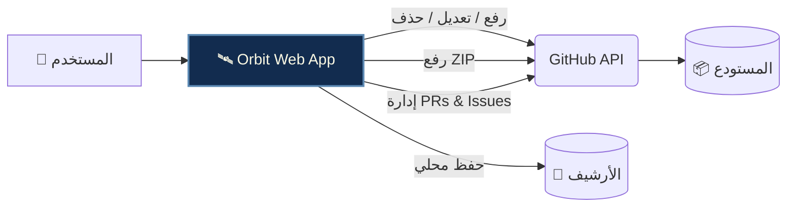

<!-- ═══════════════════════════════════════════════════════════
     HEADER BANNER (Animated & Luxury)
     ═══════════════════════════════════════════════════════════ -->
<div align="center">
  
  
  <br>

  

  <br>

  <a href="LICENSE-MIT"></a>
  <a href="../../releases"></a>
  <a href="#"></a>
  <a href="#"></a>
  
  <br><br>

  <!-- تأكد من حفظ اللوجو الخاص بك باسم logo.png في نفس المجلد -->
  
</div>

<br>

<!-- ═══════════════════════════════════════════════════════════
     LANGUAGE TOGGLE
     ═══════════════════════════════════════════════════════════ -->
<div align="center">
  <h3>🌍 Choose Your Language | اختر لغتك</h3>
  <p>
    <a href="#arabic"><kbd>🇸🇦 العربية</kbd></a> &nbsp;&nbsp;|&nbsp;&nbsp; 
    <a href="#english"><kbd>🇬🇧 English</kbd></a>
  </p>
</div>

---

<!-- ═══════════════════════════════════════════════════════════
     ARABIC SECTION
     ═══════════════════════════════════════════════════════════ -->
<div id="arabic" dir="rtl" align="right">

## 🌟 نظرة عامة
**Orbit** ليست مجرد أداة رفع ملفات، بل هي **بيئة عمل متكاملة (SPA)** لإدارة مستودعات GitHub تعمل بالكامل داخل متصفحك. تم بناؤها باستخدام **Vanilla JavaScript** (بدون أطر عمل ثقيلة) وتعتمد مباشرة على **GitHub REST API** و **Git Data API** لإجراء عمليات معقدة.

صُممت Orbit لتكون البديل البصري الأسهل لمن لا يريد استخدام `Terminal` أو `Git`، حيث تمنحك تحكماً كاملاً من واجهة واحدة أنيقة.



<br>

🎨 الهوية البصرية

<div align="center">

اللون الكود الاستخدام
⬛ Noir #000000 الخلفية الأساسية
🌑 Midnight #122C4F الأسطح المرتفعة (Cards)
🌊 Ocean #5B88B2 الأزرار والعناصر التفاعلية
🥥 Pearl #FBF9E4 النصوص والأيقونات

</div>

<br>

🤔 لماذا Orbit؟

<div align="center">

الحل التقليدي Orbit
تثبيت Git و Node.js ❌ لا يحتاج
تشغيل سيرفر ❌ لا يحتاج
استخدام سطر الأوامر ❌ لا يحتاج
تسجيل دخول معقد ❌ يكفي التوكن
جمع بياناتك ❌ خصوصية 100%
يعمل بفتح ملف HTML ✅ نعم

</div>

<br>

🚀 مميزات تقنية دقيقة (Technical Deep Dive)

📁 الرفع الذكي (Upload Module)

· الرفع المتوازي: معالجة ورفع 4 ملفات في نفس الوقت لتسريع العملية.
· الرفع كـ ZIP: دمج مكتبة JSZip لضغط المشاريع الكبيرة ورفعها بـ Commit واحد.
· File System Access API: قراءة المجلدات المحلية مباشرة (حتى 8 مستويات) مع تجاهل node_modules و .git تلقائياً.
· وضع الحذف (Delete Mode): تحديد ملفات وإزالتها من قائمة الرفع قبل بدء العملية.

🛠️ التحكم المطلق (Git Trees API)

· إدارة المجلدات: استخدام Git Trees API لعمليات النقل والنسخ وإعادة التسمية (Commit واحد سريع).
· المحرر المدمج: محرر CodeMirror 6 مع تلوين لغوي وواجهة GitHub Style (Path Chips).

📚 إدارة المجتمع (Community)

· Pull Requests: إنشاء، دمج (Merge)، أو إغلاق الطلبات.
· Issues: إدارة البلاغات مع التصنيفات.
· Releases: إنشاء إصدارات (Tags) مع خيارات Draft.

<br>

📖 التبويبات العشرة

التبويب الوصف
⚙️ الإعداد التوكن، المستودعات النشطة، وإنشاء مستودع جديد.
📤 الرفع اختيار الملفات، تحديد وجهة الرفع، خيار ZIP، ومتابعة التقدم.
⚡ التحكم شجرة المستودع، المحرر، النسخ، النقل، والفروع.
📝 المسودات حفظ واسترجاع نصوص أو أكواد قبل رفعها.
🔀 الطلبات إدارة Pull Requests.
⚠️ البلاغات إدارة Issues.
🏷️ الإصدارات إدارة Releases.
📊 الإحصائيات معلومات عن حجم المستودع، اللغات، والنشاط.
💻 الأحداث سجل مباشر (Console) لكل إجراء.
🎛️ الإعدادات الثيمات، الأرشيف، الخصوصية، والاختصارات.

<br>

🏗️ البنية التحتية والملفات

```text
Orbit/
├── orbit.html            # صفحة التطبيق الرئيسية
├── logo.png              # اللوجو
├── LICENSE-MIT           # رخصة مفتوحة المصدر
├── LICENSE-COMMERCIAL    # رخصة تجارية
├── css/
│   ├── orbit.css         # التنسيقات الرئيسية
│   └── orbit-icons.css   # مكتبة أيقونات (CSS Masks - بدون SVG)
└── js/
    ├── core.js           # إدارة الحالة، التخزين، والثيمات
    ├── api.js            # الاتصال بـ GitHub API
    ├── repos.js          # إدارة المستودعات والتوكن
    ├── upload.js         # منطق الرفع الفردي و ZIP
    ├── editor.js         # محرر CodeMirror 6
    ├── remote.js         # شجرة الملفات (Git Trees API)
    └── community.js      # PRs و Issues و Releases
```

<br>

🚀 البدء السريع

1. احصل على GitHub Token من github.com/settings/tokens (صلاحية repo).
2. قم بتشغيل الملف orbit.html مباشرة في متصفحك.
3. الصق التوكن، اضغط "تحقق"، وابدأ العمل فوراً!

💡 نصيحة: للحصول على أفضل أداء لاكتشاف المجلدات، شغل الأداة عبر سيرفر محلي: python -m http.server 8000

<br>

❓ الأسئلة الشائعة

<details>
<summary><b>🔍 لماذا لا يعمل الاكتشاف التلقائي للملفات؟</b></summary>
<br>
المتصفحات تمنع قراءة محتوى المجلدات عند فتح الملف عبر <code>file://</code> لأسباب أمنية. <br>
<b>الحل:</b> استخدم زر "اختر مجلد" يدوياً، أو شغّل الصفحة عبر سيرفر محلي (<code>python -m http.server</code>).
</details>

<details>
<summary><b>🔐 هل حفظ التوكن آمن؟</b></summary>
<br>
لأقصى درجات الأمان، لا تفعل خيار "تذكر التوكن" على الأجهزة المشتركة. الأفضل استخدام <b>Fine-grained Token</b> بتاريخ انتهاء قصير مخصص لمستودع واحد فقط.
</details>

<details>
<summary><b>🚀 ما هي ميزة الرفع كـ ZIP؟</b></summary>
<br>
إذا كان لديك مشروع يحتوي على مئات الملفات، فإن رفعها فردياً سيستغرق وقتاً. ميزة ZIP تقوم بضغط كل الملفات في ملف واحد ورفعه دفعة واحدة، مما يختصر الوقت والطلبات.
</details>

<br>

⌨️ اختصارات لوحة المفاتيح

الاختصار الوظيفة
<kbd>Ctrl</kbd> + <kbd>K</kbd> فتح / إغلاق الإعدادات
<kbd>Alt</kbd> + <kbd>1-9</kbd> التبديل السريع بين التبويبات
<kbd>Ctrl</kbd> + <kbd>S</kbd> حفظ في المحرر
<kbd>Ctrl</kbd> + <kbd>Enter</kbd> بدء الرفع
<kbd>Esc</kbd> إغلاق النوافذ

</div>

---

<!-- ═══════════════════════════════════════════════════════════
     ENGLISH SECTION
     ═══════════════════════════════════════════════════════════ -->

<div id="english" dir="ltr" align="left">

<br>

🌟 Overview

Orbit is a fully client-side Single Page Application (SPA) that lets you manage GitHub repositories entirely from your browser. Built with Vanilla JavaScript (no heavy frameworks) and powered directly by the GitHub REST API & Git Data API for complex operations.

<br>

🎨 Visual Identity

<div align="center">

Color Code Usage
⬛ Noir #000000 Base Background
🌑 Midnight #122C4F Elevated Surfaces (Cards)
🌊 Ocean #5B88B2 Interactive Elements
🥥 Pearl #FBF9E4 Text & Icons

</div>

<br>

🤔 Why Orbit?

<div align="center">

Traditional Way Orbit
Install Git & Node.js ❌ Not Needed
Run a Server ❌ Not Needed
Use Terminal ❌ Not Needed
Complex Login ❌ Token is Enough
Data Collection ❌ 100% Privacy
Runs by Opening HTML ✅ Yes

</div>

<br>

🚀 Technical Deep Dive

📁 Smart Upload Module

· Parallel Uploads: Concurrently processes 4 files via Fetch.
· ZIP Mode: Integrates JSZip for single-commit large project uploads.
· File System Access API: Scans directories (up to 8 levels) with auto-exclusion for node_modules & .git.
· Delete Mode: Select files to remove from the queue.

🛠️ Absolute Control (Git Trees API)

· Folder Ops: Ultra-fast moving, copying, and renaming via Git Trees API.
· Built-in Editor: CodeMirror 6 with syntax highlighting & GitHub-style UI.

<br>

📖 The 10 Tabs

Tab Description
⚙️ Setup Token, active repos, new repo creation.
📤 Upload File selection, target paths, ZIP mode, progress.
⚡ Remote Repo tree, editor, copy/move, branches.
📝 Drafts Save & restore local texts.
🔀 Pulls Manage Pull Requests.
⚠️ Issues Manage Issues.
🏷️ Releases Manage Releases.
📊 Stats Repo size, languages, activity.
💻 Logs Live console for actions.
🎛️ Settings Themes, Archive, Privacy, Shortcuts.

<br>

🏗️ Project Structure

```text
Orbit/
├── orbit.html            # Main App HTML
├── logo.png              # Brand Logo
├── LICENSE-MIT           # Open Source License
├── LICENSE-COMMERCIAL    # Commercial License
├── css/
│   ├── orbit.css         # Main Styles
│   └── orbit-icons.css   # Zero-SVG icon library (CSS Masks)
└── js/
    ├── core.js           # State, Storage, Themes
    ├── api.js            # GitHub API wrapper
    ├── repos.js          # Repo & Token management
    ├── upload.js         # Upload (Files & ZIP)
    ├── editor.js         # CodeMirror 6
    ├── remote.js         # Repo tree (Git Trees API)
    └── community.js      # PRs, Issues, Releases
```

<br>

🚀 Quick Start

1. Get a GitHub Token from github.com/settings/tokens (scope: repo).
2. Open orbit.html directly in your browser.
3. Paste the token, click "Verify", and start working!

💡 Tip: For best directory-scanning performance, run via a local server: python -m http.server 8000

<br>

❓ FAQ

<details>
<summary><b>🔍 Why does auto-detection not work?</b></summary>
<br>
Browsers block directory reading via <code>file://</code> for security. <br>
<b>Fix:</b> Use "Select Folder" manually, or run a local server.
</details>

<details>
<summary><b>🔐 Is saving the token safe?</b></summary>
<br>
Do not enable "Remember Me" on shared devices. It's best to use a <b>Fine-grained Token</b> with a short expiration.
</details>

<details>
<summary><b>🚀 What is ZIP mode?</b></summary>
<br>
If you have hundreds of files, uploading them individually takes time. ZIP mode compresses everything into one file, saving time and API requests.
</details>

<br>

⌨️ Keyboard Shortcuts

Shortcut Action
<kbd>Ctrl</kbd> + <kbd>K</kbd> Toggle Settings
<kbd>Alt</kbd> + <kbd>1-9</kbd> Switch Tabs
<kbd>Ctrl</kbd> + <kbd>S</kbd> Save in Editor
<kbd>Ctrl</kbd> + <kbd>Enter</kbd> Start Upload
<kbd>Esc</kbd> Close Modals

<br>

📜 License

This project operates under a Dual Licensing model:

· For personal & open-source use: See LICENSE-MIT.
· For commercial use: See LICENSE-COMMERCIAL.

</div>

---

<!-- ═══════════════════════════════════════════════════════════
     FOOTER
     ═══════════════════════════════════════════════════════════ -->

<br>
<div align="center">
  


<b>صُنع بشغف بواسطة Fix "Yousef" ⚜️</b>

<sub>Orbit v2.3.0 © 2026 — MIT & Commercial License</sub>


<a href="#"></a>
<a href="#"></a>
<a href="#"></a>

</div>
