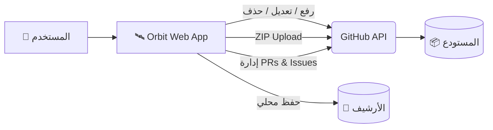

<div align="center">
    
  
  <br><br>
  
  <h1>🛰️ Orbit</h1>
  
  <p><b>ارفع مشروعك كاملاً إلى GitHub — من المتصفح، بدون سيرفر، بدون تثبيت، وبدون تعقيد.</b></p>
  <p>أداة ويب واحدة. صفر تبعيات. تحكم مطلق.</p>

  <p>
    <a href="LICENSE"></a>
    <a href="../../releases"></a>
    <a href="#"></a>
    <a href="#"></a>
  </p>
</div>

---

## 🎯 نظرة عامة

**Orbit** ليست مجرد أداة رفع ملفات، بل هي **بيئة عمل كاملة** تعمل بالكامل داخل متصفحك. تعتمد على **GitHub REST API** مباشرة عبر `fetch()` — مما يعني **لا وسطاء، لا سيرفرات، ولا جمع بيانات**.

صُممت Orbit لتكون البديل البصري الأسهل لمن لا يريد استخدام `Terminal` أو `Git`، حيث تمنحك تحكماً كاملاً في مستودعاتك، ملفاتك، طلبات السحب (PRs)، والبلاغات (Issues) من واجهة واحدة أنيقة.



---

🎨 الهوية البصرية

<div align="center">

اللون الكود الاستخدام
⬛ Noir #000000 الخلفية الأساسية
🌑 Midnight #122C4F الأسطح المرتفعة (Cards)
🌊 Ocean #5B88B2 الأزرار والعناصر التفاعلية
🥥 Pearl #FBF9E4 النصوص والأيقونات

</div>

---

✨ المميزات

🔐 الأمان والمصادقة

· الخصوصية أولاً: التوكن يُحفظ في الذاكرة فقط افتراضياً.
· حفظ اختياري (30 يوماً): إمكانية الحفظ المحلي بموافقتك الصريحة مع تحذير أمني.
· دعم Fine-grained Tokens: لتقييد الصلاحيات بمستودع واحد فقط.
· مؤشر Rate Limit: عرض مباشر للحد الأقصى من الطلبات المتبقية.

📁 إدارة الملفات والرفع

· رفع ZIP ذكي (جديد 🚀): ضغط مئات الملفات في ملف .zip واحد ورفعها كـ Commit واحد (أسرع بكثير للمشاريع الكبيرة).
· اكتشاف تلقائي: قراءة المجلدات المحلية حتى عمق 8 مستويات (تجاهل node_modules و .git تلقائياً).
· شجرة تفاعلية: عرض هرمي للملفات مع إمكانية تحديد/إلغاء التحديد.
· وضع الحذف (Delete Mode): تحديد ملفات معينة وإزالتها من قائمة الرفع قبل بدء العملية.

🛠️ التحكم المطلق (Repo Tools)

· المحرر المدمج: تعديل الملفات مباشرة عبر محرر CodeMirror 6 مع تلوين لغوي.
· عمليات متقدمة: نسخ، نقل، وإعادة تسمية الملفات والمجلدات.
· النقل بين المستودعات: نقل ملف أو مجلد كامل من مستودع لآخر.
· إدارة الفروع: إنشاء وتبديل الفروع بسهولة.
· توليد README تلقائياً: أداة ذكية لتحليل المشروع وإنشاء ملف README.md احترافي.

📚 إدارة شاملة من صفحة واحدة

· Pull Requests: إنشاء، دمج، أو إغلاق الطلبات.
· Issues: إدارة البلاغات مع التصنيفات (Labels).
· Releases: إنشاء إصدارات (Tags) وتحديدها كـ Pre-release أو Draft.

🎨 تجربة المستخدم (UI/UX)

· ثنائي اللغة: دعم كامل للعربية (RTL) والإنجليزية (LTR).
· الوضع الليلي والنهاري: تبديل فوري بين الثيمات.
· أرشيف محلي: تسجيل كامل لكل العمليات مع إمكانية التصدير بصيغة JSON.
· PWA Ready: إمكانية تثبيت التطبيق على جهازك.

---

🤔 لماذا Orbit؟

<div align="center">

الحل التقليدي Orbit
تثبيت Git و Node.js ❌ لا يحتاج
تشغيل سيرفر ❌ لا يحتاج
استخدام سطر الأوامر ❌ لا يحتاج
تسجيل دخول معقد ❌ يكفي التوكن
جمع بياناتك ❌ خصوصية 100%
يعمل بفتح ملف HTML ✅ نعم

</div>

---

🚀 البدء السريع

1️⃣ احصل على GitHub Token

1. اذهب إلى github.com/settings/tokens.
2. اختر Generate new token.
3. حدد الصلاحية repo (أو استخدم Fine-grained token للخصوصية).
4. انسخ التوكن.

[!WARNING]
تنبيه أمني: لا تشارك التوكن مع أي شخص. إذا تم تسريبه، قم بحذفه فوراً من إعدادات GitHub.

2️⃣ شغل الأداة

افتح ملف orbit.html مباشرة في المتصفح، أو قم بتشغيله عبر سيرفر محلي (للحصول على أفضل أداء):

```bash
python -m http.server 8000
# ثم افتح http://localhost:8000/orbit.html
```

3️⃣ ابدأ العمل

الصق التوكن في صفحة الإعداد → اضغط "تحقق" → سيتم جلب مستودعاتك → ابدأ الرفع والتحكم!

---

📖 التبويبات العشرة

التبويب الوصف
⚙️ الإعداد التوكن، المستودعات النشطة، وإنشاء مستودع جديد.
📤 الرفع اختيار الملفات، تحديد وجهة الرفع، خيار ZIP، ومتابعة التقدم.
⚡ التحكم شجرة المستودع، المحرر، النسخ، النقل، الفروع، وإدارة المجلدات.
📝 المسودات حفظ واسترجاع نصوص أو أكواد قبل رفعها.
🔀 الطلبات إدارة Pull Requests.
⚠️ البلاغات إدارة Issues.
🏷️ الإصدارات إدارة Releases.
📊 الإحصائيات معلومات عن حجم المستودع، اللغات، والنشاط.
💻 الأحداث سجل مباشر (Console) لكل إجراء تقوم به.
🎛️ الإعدادات الثيمات، الأرشيف، الخصوصية، الشروط، والاختصارات.

---

⌨️ اختصارات لوحة المفاتيح

الاختصار الوظيفة
<kbd>Ctrl</kbd> + <kbd>K</kbd> فتح / إغلاق الإعدادات
<kbd>Alt</kbd> + <kbd>1-9</kbd> التبديل السريع بين التبويبات
<kbd>Ctrl</kbd> + <kbd>S</kbd> حفظ في المحرر
<kbd>Ctrl</kbd> + <kbd>Enter</kbd> بدء الرفع (في تبويب الرفع)
<kbd>Esc</kbd> إغلاق النوافذ المنبثقة

---

❓ الأسئلة الشائعة

<details>
<summary><b>🔍 لماذا لا يعمل الاكتشاف التلقائي للملفات؟</b></summary>
<br>
المتصفحات تمنع قراءة محتوى المجلدات عند فتح الملف عبر <code>file://</code> لأسباب أمنية. <br>
<b>الحل:</b> استخدم زر "اختر مجلد" يدوياً، أو شغّل الصفحة عبر سيرفر محلي (<code>python -m http.server</code>).
</details>

<details>
<summary><b>🔐 هل حفظ التوكن آمن؟</b></summary>
<br>
لأقصى درجات الأمان، لا تفعل خيار "تذكر التوكن" على الأجهزة المشتركة. الأفضل استخدام <b>Fine-grained Token</b> بتاريخ انتهاء قصير ومخصص لمستودع واحد فقط.
</details>

<details>
<summary><b>🚀 ما هي ميزة الرفع كـ ZIP؟</b></summary>
<br>
إذا كان لديك مشروع يحتوي على مئات الملفات، فإن رفعها فردياً سيستغرق وقتاً طويلاً بسبب حدود GitHub API. ميزة ZIP تقوم بضغط كل الملفات في ملف واحد ورفعه دفعة واحدة، مما يختصر الوقت والطلبات بشكل هائل.
</details>

---

📄 الترخيص

هذا المشروع مرخص تحت رخصة MIT. 
يرجى الاطلاع على ملف LICENSE لمزيد من التفاصيل.

<div align="center">
  <br>
  <b>صُنع بشغف بواسطة Fix "Yousef" ⚜️</b><br>
  <sub>Orbit v3.0.5 © 2026</sub>
</div>
