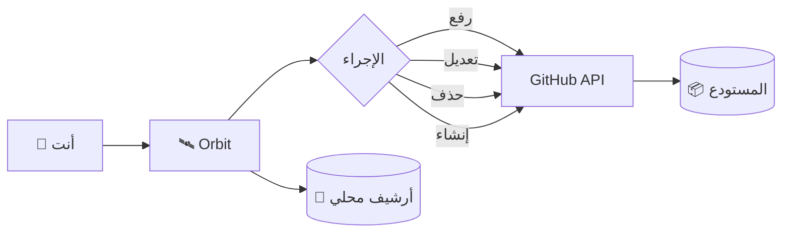

# 🛰️ Orbit

<div align="center">

**ارفع مشروعك كامل إلى GitHub — من المتصفح، بدون سيرفر، بدون مكتبات، بدون تعقيد.**

[](LICENSE)
[](../../releases)
[](#)
[](#)

**أداة ويب واحدة. صفر تبعيات. تحكم كامل.**

</div>

---

## 🎨 الهوية البصرية

<div align="center">

| اللون | الكود | الاستخدام |
|:-----:|:-----:|:---------:|
| 🌑 **Midnight** | `#122C4F` | الأسطح المرتفعة |
| 🌊 **Ocean** | `#5B88B2` | اللون الأساسي |
| 🥥 **Pearl** | `#FBF9E4` | النص الأساسي |
| ⬛ **Noir** | `#000000` | الخلفية |

</div>

---

## 🎯 نظرة عامة

**Orbit** أداة ويب مستقلة — ملف `HTML` واحد يعمل في أي متصفح حديث — تتيح لك رفع مشروع كامل إلى **GitHub** مباشرة، مع **تحكم كامل** في الملفات داخل المستودع، **أرشيف** لكل العمليات، و**أمان** يبقى في يدك.

تعمل الأداة على **GitHub REST API** مباشرة عبر `fetch()` — لا وسطاء، لا سيرفرات، لا جمع بيانات.



---

## ✨ المميزات

### 🔐 المصادقة والأمان

- **التوكن في الذاكرة فقط** — تحقق فوري، قراءة الصلاحيات تلقائيًا، لا يُحفظ في `localStorage` افتراضيًا
- **حفظ اختياري مقيّد** — تفعيل "تذكّر لمدة 30 يومًا" برغبتك الصريحة مع تحذير أمني واضح
- **لا يُرسل لأي جهة** — كل الاتصالات عبر `api.github.com` فقط

### 📁 إدارة الملفات

- **اكتشاف تلقائي** — قراءة قائمة المجلد عبر `fetch('./')` حتى عمق 8 مستويات
- **تجاهل تلقائي** — `.git`, `node_modules`, `.cache` وغيرها
- **4 طرق للإضافة** — اختر ملفات / اختر مجلد / سحب وإفلات / مسارات يدوية
- **شجرة تفاعلية** — عرض هرمي مع Checkbox و`indeterminate` للمجلدات

### 🚀 الرفع إلى GitHub

- **رفع متوازٍ** — 4 ملفات تُرفع في نفس الوقت
- **Base64 + SHA صحيح** — عبر Git Data API
- **إنشاء تلقائي** — للمستودع لو لم يكن موجودًا
- **Progress مباشر** — مع اسم الملف الحالي

### 🛠️ أدوات التحكم

- **تعديل مباشر** — افتح أي ملف، عدّل، احفظ
- **حذف** — بزر واحد مع تأكيد
- **إنشاء** — ملفات جديدة بمسار مخصص
- **Rate Limit مباشر** — عرض الحد المتبقي في الهيدر

### 📚 الأرشيف المحلي

- **سجل كامل** — كل عملية تُسجّل تلقائيًا
- **تفاصيل كاملة** — التاريخ، الملفات، Commit SHA، المدة، الحالة
- **تصدير JSON** — بنقرة واحدة
- **200 عملية** كحد أقصى (الأقدم يُحذف تلقائيًا)

### 🎨 الواجهة

- **باليتة أصيلة** — Midnight · Ocean · Pearl · Noir
- **أيقونات خطية مخصصة** — بدون مكتبات
- **RTL كامل** — للعربية
- **5 تبويبات** منظمة — لا تكديس
- **Responsive** — على كل الشاشات
- **صفر مكتبات CSS/JS خارجية**

---

## 🤔 لماذا Orbit؟

<div align="center">

| الحل التقليدي | Orbit |
|:---:|:---:|
| تثبيت Git | ❌ |
| تثبيت Node.js | ❌ |
| تشغيل سيرفر | ❌ |
| مكتبات خارجية | ❌ |
| استخدام Terminal | ❌ |
| تسجيل دخول GitHub | ❌ |
| حفظ أي بيانات عنك | ❌ |
| **يعمل بفتح HTML** | ✅ |

</div>

---

## 📦 التثبيت

### الطريقة 1 — تحميل مباشر

```bash
curl -O https://raw.githubusercontent.com/T7-T7/BOT-STEAM/main/Orbit/orbit.html
```

أو من المتصفح:

<div align="center">

[](../../raw/main/Orbit/orbit.html)

</div>

### الطريقة 2 — استنساخ المستودع

```bash
git clone https://github.com/T7-T7/BOT-STEAM.git
cd BOT-STEAM/Orbit
```

### الطريقة 3 — نسخ يدوي

1. اضغط **Code** → **Download ZIP**
2. فك الضغط في أي مكان
3. افتح `orbit.html` في المتصفح

> [!TIP]
> ### ⚡ للأداء الأفضل
>
> شغّل المشروع على **سيرفر محلي** لتفعيل الاكتشاف التلقائي:
>
> ```bash
> python -m http.server 8000
> # أو
> npx serve
> ```
>
> ثم افتح: `http://localhost:8000/orbit.html`

---

## 🚀 البدء السريع

### 1️⃣ احصل على GitHub Token

افتح [github.com/settings/tokens](https://github.com/settings/tokens) → **Generate new token** → اختر صلاحية `repo` → انسخ التوكن فورًا.

> [!WARNING]
> **لأمان أعلى**: استخدم **Fine-grained Token** مقيّد لمستودع واحد فقط، مع صلاحيات `Contents: RW` + `Administration: RW`، وتاريخ انتهاء قصير.

### 2️⃣ افتح الصفحة

```
📂 Orbit/
├── 📄 orbit.html    ← افتح هذا
├── 📄 index.html
├── 📁 css/
└── 📁 js/
```

### 3️⃣ أدخل التوكن واسم المستودع

```
┌──────────────────────────────────────────┐
│  🔑  ghp_xxxxxxxxxxxxxxxxxxxxxxxxxxxx    │
└──────────────────────────────────────────┘

┌──────────────────────────────────────────┐
│  T7-T7 / [BOT-STEAM                ]     │
└──────────────────────────────────────────┘
```

### 4️⃣ اكتشف الملفات → 5️⃣ اضبط المسارات → 6️⃣ ارفع 🚀

---

## 📖 التبويبات الخمسة

| التبويب | المحتوى |
|:-------:|:--------|
| ⚙️ **الإعداد** | التوكن، اسم المستودع، الخصوصية، رسالة Commit |
| 📤 **الرفع** | اختيار الملفات، إعداد المسار، شجرة، Progress |
| ⚡ **التحكم** | تحميل المستودع، تعديل، حذف، إنشاء ملفات |
| 📚 **السجل** | كل العمليات مع التفاصيل الكاملة |
| 💻 **الأحداث** | السجل المباشر للجلسة |

---

## 🛠️ أدوات التحكم

- **📂 تحميل محتوى المستودع** — شجرة كاملة لكل الملفات
- **✏️ تعديل ملف** — افتح، عدّل، احفظ
- **🗑️ حذف ملف** — مع تأكيد
- **➕ إنشاء ملف جديد** — بمسار مخصص

---

## 📚 سجل العمليات

كل عملية تُسجَّل تلقائيًا مع:

| الحقل | الوصف |
|:-----:|:------|
| 🕐 | التاريخ والوقت الكامل |
| 🏷️ | نوع العملية |
| 📦 | قائمة الملفات مع الحجم |
| 🔗 | Commit SHA مع رابط مباشر |
| ⏱️ | المدة بالثواني |
| ✅ | الحالة |

---

## 🔒 الأمان

### ⚠️ تحذيرات مهمة

> [!CAUTION]
> **لا تُفعّل "تذكر التوكن" على أجهزة مشتركة**. أي شخص يستخدم نفس الجهاز يمكنه قراءته من DevTools.

> [!IMPORTANT]
> **استخدم Fine-grained Token** بدل `repo` — صلاحيات محددة لمستودع واحد فقط.

> [!TIP]
> **نصائح إضافية**:
> 1. فعّل **2FA** على حسابك
> 2. راجع **Settings → Sessions** شهريًا
> 3. لا تشارك التوكن مع أي شخص
> 4. حدّد تاريخ انتهاء للتوكن

### 🆘 ماذا تفعل عند التسريب؟

1. افتح [github.com/settings/tokens](https://github.com/settings/tokens)
2. **احذف التوكن فورًا**
3. أنشئ توكن جديد
4. راجع Security Logs

---

## 🏗️ البنية التقنية

```
┌─────────────────────────────────────────────┐
│              orbit.html                     │
│          ملف واحد — صفر تبعيات                  │
├─────────────────────────────────────────────┤
│   HTML5 · CSS3 · Vanilla JS (ES6+)          │
│   Fetch API · DOMParser · LocalStorage      │
├─────────────────────────────────────────────┤
│         GitHub REST API v3                  │
│         اتصال مباشر — لا وسطاء                   │
└─────────────────────────────────────────────┘
```

| المكوّن | الوظيفة | التقنية |
|:-------:|:--------|:--------|
| 🎨 الواجهة | عرض + تفاعل | HTML5 + CSS3 Variables |
| 🔐 مدير التوكن | تحقق + حفظ اختياري | GitHub API + localStorage |
| 📁 مستكشف الملفات | اكتشاف + شجرة | `fetch()` + `DOMParser` |
| 🚀 مدير الرفع | Base64 + Blobs | Git Data API + `Promise.all` |
| 🛠️ أدوات التحكم | CRUD على الملفات | Contents API |
| 📚 السجل | تتبع العمليات | localStorage |

---

## ❓ الأسئلة الشائعة

<details>
<summary><b>🔍 لماذا الاكتشاف التلقائي لا يعمل عندي؟</b></summary>

الاكتشاف التلقائي يحتاج **directory listing**. المتصفحات تمنع قراءة محتوى المجلد من `file://` لأسباب أمنية.

**الحل**: شغّل سيرفر محلي:
```bash
python -m http.server 8000
```
ثم افتح `http://localhost:8000/orbit.html`

أو استخدم زر **"اختر ملفات"** أو **"اختر مجلد"**.

</details>

<details>
<summary><b>📱 كيف أرفع من الأندرويد؟</b></summary>

استخدم زر **"اختر ملفات"** — الاختيارات **تتراكم** مع كل مرة. لو محتاج مجلد فرعي، اكتب المسار في "مسار نسبي" (مثل `css/`).

</details>

<details>
<summary><b>🔐 هل حفظ التوكن آمن؟</b></summary>

**ليس مثاليًا** لكنه مقبول بشرط:
- ✅ على جهازك الشخصي فقط
- ✅ Fine-grained Token
- ✅ مستودع واحد فقط
- ✅ مع تاريخ انتهاء

</details>

<details>
<summary><b>📁 استخدمت مسار خطأ — كيف أصلحه؟</b></summary>

**قبل الرفع**: راجع المعاينة في "مسار نسبي".
**بعد الرفع**: احذف الملفات من GitHub وأعد الرفع.

</details>

<details>
<summary><b>🔄 هل تعمل مع المستودعات الموجودة؟</b></summary>

**نعم!** يرفع فوق الملفات القديمة، ينشئ Commit جديد، ولا يمسح شيئًا.

</details>

---

## 🗺️ خطة التطوير

### ✅ تم إنجازه

- [x] اكتشاف تلقائي للملفات
- [x] شجرة تفاعلية
- [x] رفع متوازٍ (4 ملفات)
- [x] تعديل / حذف / إنشاء ملفات
- [x] Rate limit مباشر
- [x] حفظ اختياري للتوكن
- [x] أرشيف محلي كامل
- [x] RTL كامل

### 🚧 قيد التطوير

- [ ] متعدد المستودعات
- [ ] نسخ / نقل ملفات
- [ ] إنشاء فروع
- [ ] Pull Requests
- [ ] Issues
- [ ] Releases

### 🔮 المدى البعيد

- [ ] PWA — يعمل offline
- [ ] ثيم فاتح/داكن
- [ ] لغات متعددة
- [ ] اختصارات لوحة المفاتيح

---

## 🤝 المساهمة

- ⭐ **إعجاب** — اضغط Star
- 🐛 **إبلاغ** — [افتح Issue](../../issues/new)
- 🎁 **اقتراح** — بعنوان `[Feature] ...`
- 💻 **Pull Request** — Fork → Branch → Commit → PR

### قواعد الكود

```javascript
// ✅ استخدم
const, let · async/await · ?. ?? · template literals · textContent

// ❌ تجنب
var · callback hell · global variables · eval() · innerHTML مع مدخلات
```

---

## 📄 الترخيص

<div align="center">

[](LICENSE)

**هذا المشروع مُرخّص بموجب رخصة MIT**

© 2026 Yousef "Fix" — [T7-T7](https://github.com/T7-T7)

</div>

يمكنك الاستخدام التجاري، التعديل، التوزيع، والاستخدام الخاص — بشرط الاحتفاظ بحقوق النشر وإرفاق نسخة من الرخصة.

---

<div align="center">

## 🌟 شكر خاص

شكرًا لكل من ساهم في هذا المشروع.

### 💫 إذا أفادك المشروع

**اضغط ⭐ لدعم المشروع**

[](../../stargazers)
[](../../network/members)
[](../../watchers)

---

**صُنع بواسطة Fix "Yousef⚜️"**

<sub><strong>Orbit</strong> © 2026 — [MIT License](LICENSE)</sub>

</div>
