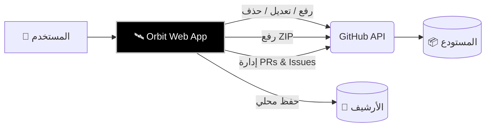
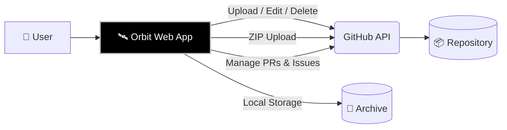

<!-- ═══════════════════════════════════════════════════════════
     ORBIT — README (2026 Modern Standard)
     - Centered Hero & Tagline
     - Functional Badges (No vanity clutter)
     - Quick Start above the fold
     - Bilingual (AR/EN) with HTML tables for perfect rendering
     ═══════════════════════════════════════════════════════════ -->

<div align="center">

<!-- Hero Banner -->


<!-- Logo + Title -->
<h1>
  
  Orbit
</h1>

<!-- One-line Positioning -->
<p><strong>Manage GitHub repositories entirely from your browser — zero servers, zero tracking, zero Git required.</strong></p>

<!-- Badges Row: Functional & Hero Button (Unified Style) -->
<p>
  <a href="LICENSE-MIT"></a>
  <a href="#"></a>
  <a href="../../releases"></a>
  <a href="#"></a>
  <a href="#"></a>
</p>

<!-- Hero Live Demo Button (Using Base64 SVG for perfect logo rendering) -->
<p>
  <a href="https://your-website.com">
    
  </a>
</p>

<!-- Language Switcher -->
<p>
  <a href="#arabic"><kbd>🇸🇦 العربية</kbd></a> &nbsp;|&nbsp; 
  <a href="#english"><kbd>🇬🇧 English</kbd></a>
</p>

</div>

---

<!-- ═══════════════════════════════════════════════════════════
     ARABIC SECTION
     ═══════════════════════════════════════════════════════════ -->
<div id="arabic" dir="rtl" align="right">

## 🌟 نظرة عامة

**Orbit** هي بيئة عمل متكاملة (SPA) لإدارة مستودعات GitHub تعمل بالكامل داخل متصفحك. بُنيت باستخدام **Vanilla JavaScript** وتعتمد مباشرة على **GitHub REST API** و **Git Data API** لتنفيذ عمليات معقدة في ثوانٍ.

> [!NOTE]
> صُممت Orbit لتكون البديل البصري الأسهل لمن لا يريد استخدام `Terminal` أو `Git`، حيث تمنحك تحكماً كاملاً من واجهة واحدة أنيقة.



<br>

✨ الميزات الرئيسية

<table>
  <thead>
    <tr>
      <th align="right">الميزة</th>
      <th align="right">الوصف</th>
    </tr>
  </thead>
  <tbody>
    <tr>
      <td align="right">🚀 <strong>رفع فائق السرعة</strong></td>
      <td align="right">معالجة 4 ملفات بالتوازي، مع دعم <strong>الرفع كـ ZIP</strong> لضغط المشروع بالكامل ورفعه بـ Commit واحد.</td>
    </tr>
    <tr>
      <td align="right">✏️ <strong>محرر مدمج</strong></td>
      <td align="right">تعديل الملفات مباشرة عبر محرر <strong>CodeMirror 6</strong> مع إدارة الفروع، نسخ ونقل المجلدات.</td>
    </tr>
    <tr>
      <td align="right">🔐 <strong>خصوصية مطلقة</strong></td>
      <td align="right">التوكن يُحفظ في الذاكرة فقط. لا سيرفرات، لا تحليلات، ولا تتبع. أنت فقط وجيت هاب.</td>
    </tr>
    <tr>
      <td align="right">📚 <strong>إدارة شاملة</strong></td>
      <td align="right">تحكم كامل في <strong>Pull Requests</strong>، <strong>Issues</strong>، و <strong>Releases</strong> من نفس الصفحة.</td>
    </tr>
    <tr>
      <td align="right">🎨 <strong>واجهة عصرية</strong></td>
      <td align="right">دعم كامل للعربية (RTL)، ثيم ليلي ونهاري، و PWA يمكن تثبيته على جهازك.</td>
    </tr>
    <tr>
      <td align="right">📦 <strong>محلي بالكامل</strong></td>
      <td align="right">سجل كامل لكل العمليات، مع إمكانية تصديره بصيغة <code>JSON</code> في أي وقت.</td>
    </tr>
  </tbody>
</table>

<br>

🛠️ التقنيات المستخدمة

<div align="center">
  
  
  
  
  
</div>

<br>

🚀 البدء السريع

1. احصل على GitHub Token من github.com/settings/tokens (صلاحية repo).
2. قم بتشغيل الملف orbit.html مباشرة في متصفحك.
3. الصق التوكن، اضغط "تحقق"، وابدأ العمل فوراً!

[!TIP]
للحصول على أفضل أداء لاكتشاف المجلدات، شغل الأداة عبر سيرفر محلي:

```bash
python -m http.server 8000
```

<br>

🏗️ هيكل المشروع

```text
Orbit/
├── orbit.html            # صفحة التطبيق الرئيسية
├── logo.png              # اللوجو
├── LICENSE-MIT           # رخصة مفتوحة المصدر
├── LICENSE-COMMERCIAL    # رخصة تجارية
├── css/
│   ├── orbit.css         # التنسيقات الرئيسية
│   └── orbit-icons.css   # مكتبة أيقونات (CSS Masks - بدون SVG)
└── js/
    ├── core.js           # إدارة الحالة، التخزين، والثيمات
    ├── api.js            # الاتصال بـ GitHub API
    ├── repos.js          # إدارة المستودعات والتوكن
    ├── upload.js         # منطق الرفع الفردي و ZIP
    ├── editor.js         # محرر CodeMirror 6
    ├── remote.js         # شجرة الملفات (Git Trees API)
    └── community.js      # PRs و Issues و Releases
```

<br>

⌨️ اختصارات لوحة المفاتيح

<table>
  <thead>
    <tr>
      <th align="right">الاختصار</th>
      <th align="right">الوظيفة</th>
    </tr>
  </thead>
  <tbody>
    <tr>
      <td align="right"><kbd>Ctrl</kbd> + <kbd>K</kbd></td>
      <td align="right">فتح / إغلاق الإعدادات</td>
    </tr>
    <tr>
      <td align="right"><kbd>Alt</kbd> + <kbd>1-9</kbd></td>
      <td align="right">التبديل السريع بين التبويبات</td>
    </tr>
    <tr>
      <td align="right"><kbd>Ctrl</kbd> + <kbd>S</kbd></td>
      <td align="right">حفظ في المحرر</td>
    </tr>
    <tr>
      <td align="right"><kbd>Ctrl</kbd> + <kbd>Enter</kbd></td>
      <td align="right">بدء الرفع</td>
    </tr>
    <tr>
      <td align="right"><kbd>Esc</kbd></td>
      <td align="right">إغلاق النوافذ</td>
    </tr>
  </tbody>
</table>

<br>

❓ الأسئلة الشائعة

<details>
<summary><b>🔍 لماذا لا يعمل الاكتشاف التلقائي للملفات؟</b></summary>
<br>
المتصفحات تمنع قراءة محتوى المجلدات عند فتح الملف عبر <code>file://</code> لأسباب أمنية. <br>
<b>الحل:</b> استخدم زر "اختر مجلد" يدوياً، أو شغّل الصفحة عبر سيرفر محلي.
</details>

<details>
<summary><b>🔐 هل حفظ التوكن آمن؟</b></summary>
<br>
لأقصى درجات الأمان، لا تفعل خيار "تذكر التوكن" على الأجهزة المشتركة. الأفضل استخدام <b>Fine-grained Token</b> بتاريخ انتهاء قصير.
</details>

<details>
<summary><b>🧩 هل يدعم التطبيق Pull Requests و Issues؟</b></summary>
<br>
نعم، يمكنك إنشاء ومراجعة ودمج <b>Pull Requests</b>، بالإضافة إلى إدارة <b>Issues</b> و <b>Releases</b> بالكامل من داخل التطبيق.
</details>

</div>

---

<!-- ═══════════════════════════════════════════════════════════
     ENGLISH SECTION
     ═══════════════════════════════════════════════════════════ -->

<div id="english" dir="ltr" align="left">

<br>

🌟 Overview

Orbit is a complete Single Page Application (SPA) for managing GitHub repositories entirely in your browser. Built with Vanilla JavaScript and powered directly by the GitHub REST API & Git Data API for complex operations in seconds.

[!NOTE]
Orbit is the most elegant visual alternative to the Terminal. It gives you absolute control over your repositories from a single, beautiful UI.



<br>

✨ Ultra Features

<table>
  <thead>
    <tr>
      <th align="left">Feature</th>
      <th align="left">Description</th>
    </tr>
  </thead>
  <tbody>
    <tr>
      <td align="left">🚀 <strong>Blazing Fast</strong></td>
      <td align="left">Concurrently processes 4 files via Fetch. Includes <strong>ZIP Mode</strong> for single-commit large project uploads.</td>
    </tr>
    <tr>
      <td align="left">✏️ <strong>Built-in Editor</strong></td>
      <td align="left">Edit files directly via <strong>CodeMirror 6</strong>. Manage branches, copy, move, and rename files/folders.</td>
    </tr>
    <tr>
      <td align="left">🔐 <strong>Absolute Privacy</strong></td>
      <td align="left">Your token stays in memory. No servers, no analytics, no tracking. Just you and GitHub.</td>
    </tr>
    <tr>
      <td align="left">📚 <strong>Complete Management</strong></td>
      <td align="left">Full control over <strong>Pull Requests</strong>, <strong>Issues</strong>, and <strong>Releases</strong> all from one page.</td>
    </tr>
    <tr>
      <td align="left">🎨 <strong>Modern UI</strong></td>
      <td align="left">Full Arabic (RTL) support, Dark/Light themes, and PWA-ready to install on your device.</td>
    </tr>
    <tr>
      <td align="left">📦 <strong>Fully Local</strong></td>
      <td align="left">Comprehensive operation log, with one-click export to <code>JSON</code> whenever you need it.</td>
    </tr>
  </tbody>
</table>

<br>

🛠️ Tech Stack

<div align="center">
  
  
  
  
  
</div>

<br>

🚀 Quick Start

1. Get a GitHub Token from github.com/settings/tokens (scope: repo).
2. Open orbit.html directly in your browser.
3. Paste the token, click "Verify", and start working!

[!TIP]
For best directory-scanning performance, run via a local server:

```bash
python -m http.server 8000
```

<br>

🏗️ Project Structure

```text
Orbit/
├── orbit.html            # Main App HTML
├── logo.png              # Brand Logo
├── LICENSE-MIT           # Open Source License
├── LICENSE-COMMERCIAL    # Commercial License
├── css/
│   ├── orbit.css         # Main Styles
│   └── orbit-icons.css   # Zero-SVG icon library (CSS Masks)
└── js/
    ├── core.js           # State, Storage, Themes
    ├── api.js            # GitHub API wrapper
    ├── repos.js          # Repo & Token management
    ├── upload.js         # Upload (Files & ZIP)
    ├── editor.js         # CodeMirror 6
    ├── remote.js         # Repo tree (Git Trees API)
    └── community.js      # PRs, Issues, Releases
```

<br>

⌨️ Keyboard Shortcuts

<table>
  <thead>
    <tr>
      <th align="left">Shortcut</th>
      <th align="left">Action</th>
    </tr>
  </thead>
  <tbody>
    <tr>
      <td align="left"><kbd>Ctrl</kbd> + <kbd>K</kbd></td>
      <td align="left">Toggle Settings</td>
    </tr>
    <tr>
      <td align="left"><kbd>Alt</kbd> + <kbd>1-9</kbd></td>
      <td align="left">Switch Tabs</td>
    </tr>
    <tr>
      <td align="left"><kbd>Ctrl</kbd> + <kbd>S</kbd></td>
      <td align="left">Save in Editor</td>
    </tr>
    <tr>
      <td align="left"><kbd>Ctrl</kbd> + <kbd>Enter</kbd></td>
      <td align="left">Start Upload</td>
    </tr>
    <tr>
      <td align="left"><kbd>Esc</kbd></td>
      <td align="left">Close Modals</td>
    </tr>
  </tbody>
</table>

<br>

❓ FAQ

<details>
<summary><b>🔍 Why does auto-detection not work?</b></summary>
<br>
Browsers block directory reading via <code>file://</code> for security. <br>
<b>Fix:</b> Use "Select Folder" manually, or run a local server.
</details>

<details>
<summary><b>🔐 Is saving the token safe?</b></summary>
<br>
Do not enable "Remember Me" on shared devices. It's best to use a <b>Fine-grained Token</b> with a short expiration.
</details>

<details>
<summary><b>🧩 Does Orbit support Pull Requests & Issues?</b></summary>
<br>
Yes — you can create, review, and merge <b>Pull Requests</b>, as well as manage <b>Issues</b> and <b>Releases</b> directly from the app.
</details>

</div>

---

<!-- ═══════════════════════════════════════════════════════════
     FOOTER
     ═══════════════════════════════════════════════════════════ -->

<br>
<div align="center">
  

  <p>
    <b>صُنع بشغف بواسطة Fix "Yousef" ⚜️</b><br>
    <sub>Orbit v2.3.0 © 2026 — MIT & Commercial License</sub>
  </p>

<a href="#"></a>
<a href="#"></a>
<a href="#"></a>

</div>
