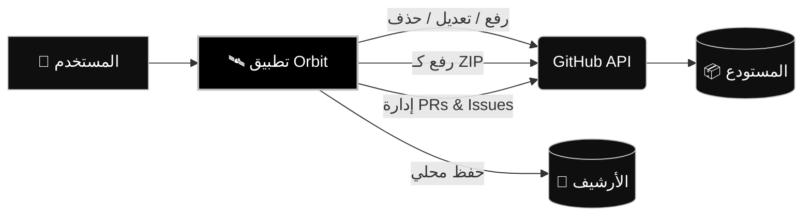

<a id="readme-top"></a>

<div dir="rtl" align="right">


<div align="center">
  
  

  <br>


  

  <br>

  

  <h1>Orbit</h1>
  
  <p><strong>أدر مستودعاتك، ارفع مشاريعك، وعدل ملفاتك بضغطة زر. بدون خوادم، بدون تتبع، وبدون الحاجة إلى Git.</strong></p>

  
  <p>
    
    
    
    
  </p>

  
  <p>
    
  </p>

</div>

---


<details>
  <summary><b>📑 جدول المحتويات (اضغط للفتح)</b></summary>
  <ol>
    <li><a href="#نظرة-عامة">نظرة عامة</a></li>
    <li><a href="#الميزات-الرئيسية">الميزات الرئيسية</a></li>
    <li><a href="#الهوية-البصرية">الهوية البصرية</a></li>
    <li><a href="#التقنيات-المستخدمة">التقنيات المستخدمة</a></li>
    <li><a href="#كيف-يعمل-التطبيق">كيف يعمل التطبيق</a></li>
    <li><a href="#البدء-السريع">البدء السريع</a></li>
    <li><a href="#اختصارات-لوحة-المفاتيح">اختصارات لوحة المفاتيح</a></li>
    <li><a href="#الأسئلة-الشائعة">الأسئلة الشائعة</a></li>
  </ol>
</details>

---


<h2 id="نظرة-عامة">🌟 نظرة عامة</h2>

**Orbit** ليست مجرد أداة رفع ملفات، بل هي **بيئة عمل متكاملة (SPA)** لإدارة مستودعات GitHub تعمل بالكامل داخل متصفحك. بُنيت باستخدام **Vanilla JavaScript** (بدون أطر عمل ثقيلة) وتعتمد مباشرة على **GitHub REST API** و **Git Data API** لتنفيذ عمليات معقدة في ثوانٍ.

صُمم هذا المشروع ليكون البديل البصري الأسهل والأكثر فخامة لمن لا يريد استخدام سطر الأوامر (`Terminal`)، حيث يمنحك تحكماً كاملاً من واجهة واحدة أنيقة.

<br>

> **💡 لماذا Orbit؟**
> وفر وقتك وتجنب تعقيدات Git. كل ما تحتاجه هو فتح ملف `orbit.html` ولصق التوكن الخاص بك، وستتمكن من إدارة مستودعاتك كالمحترفين.

<table align="center" dir="rtl" width="100%">
  <tr>
    <th align="right" width="50%">الحل التقليدي</th>
    <th align="center" width="50%">Orbit</th>
  </tr>
  <tr>
    <td align="right">تثبيت Git و Node.js</td>
    <td align="center">❌ لا يحتاج</td>
  </tr>
  <tr>
    <td align="right">تشغيل سيرفر محلي</td>
    <td align="center">❌ لا يحتاج</td>
  </tr>
  <tr>
    <td align="right">استخدام سطر الأوامر</td>
    <td align="center">❌ لا يحتاج</td>
  </tr>
  <tr>
    <td align="right">جمع بياناتك</td>
    <td align="center">❌ خصوصية 100%</td>
  </tr>
  <tr>
    <td align="right">يعمل بفتح ملف HTML</td>
    <td align="center">✅ نعم</td>
  </tr>
</table>

---


<h2 id="الميزات-الرئيسية">✨ الميزات الرئيسية</h2>

<table align="center" dir="rtl" width="100%">
  <tr>
    <td align="center" width="33%">
      <h3>🚀 رفع فائق السرعة</h3>
      <p>معالجة 4 ملفات بالتوازي، مع دعم <b>الرفع كـ ZIP</b> لضغط المشروع بالكامل ورفعه بـ Commit واحد.</p>
    </td>
    <td align="center" width="33%">
      <h3>✏️ محرر مدمج</h3>
      <p>تعديل الملفات مباشرة عبر محرر <b>CodeMirror 6</b> مع إدارة الفروع، نسخ ونقل المجلدات.</p>
    </td>
    <td align="center" width="33%">
      <h3>🔐 خصوصية مطلقة</h3>
      <p>التوكن يُحفظ في الذاكرة فقط. لا سيرفرات، لا تحليلات، ولا تتبع. أنت فقط وجيت هاب.</p>
    </td>
  </tr>
  <tr>
    <td align="center">
      <h3>📚 إدارة شاملة</h3>
      <p>تحكم كامل في <b>Pull Requests</b>، <b>Issues</b>، و <b>Releases</b> من نفس الصفحة.</p>
    </td>
    <td align="center">
      <h3>🎨 واجهة عصرية</h3>
      <p>دعم كامل للعربية (RTL)، ثيم ليلي ونهاري، و PWA يمكن تثبيته على جهازك.</p>
    </td>
    <td align="center">
      <h3>📦 محلي بالكامل</h3>
      <p>سجل كامل لكل العمليات، مع إمكانية تصديره بصيغة <code>JSON</code> في أي وقت.</p>
    </td>
  </tr>
</table>

---


<h2 id="الهوية-البصرية">🎨 الهوية البصرية (التصميم)</h2>

تم تصميم الواجهة لتكون مريحة للعين واحترافية، تعتمد على التباين العالي بين الأسود والفضي (ثيم الفخامة):

<table align="center" dir="rtl" width="100%">
  <tr>
    <th align="center" width="20%">اللون</th>
    <th align="center" width="30%">الكود</th>
    <th align="right" width="50%">الاستخدام</th>
  </tr>
  <tr>
    <td align="center">⬛ أسود (Noir)</td>
    <td align="center"><code>#000000</code></td>
    <td align="right">الخلفية الأساسية (Base Background)</td>
  </tr>
  <tr>
    <td align="center">🌑 رمادي داكن (Midnight)</td>
    <td align="center"><code>#0f0f0f</code></td>
    <td align="right">الأسطح المرتفعة (Cards)</td>
  </tr>
  <tr>
    <td align="center">🌊 فضي (Silver)</td>
    <td align="center"><code>#c0c0c0</code></td>
    <td align="right">الأزرار والعناصر التفاعلية</td>
  </tr>
  <tr>
    <td align="center">🥥 أبيض لؤلؤي (Pearl)</td>
    <td align="center"><code>#ffffff</code></td>
    <td align="right">النصوص والأيقونات</td>
  </tr>
</table>

---


<h2 id="التقنيات-المستخدمة">🛠️ التقنيات المستخدمة</h2>

تم بناء التطبيق باستخدام تقنيات الويب الأساسية لضمان السرعة القصوى وعدم وجود اعتماديات ثقيلة:

<p align="center">
  
  
  
  
  
</p>

---


<h2 id="كيف-يعمل-التطبيق">⚙️ كيف يعمل التطبيق؟</h2>

يوضح المخطط التالي بنية التطبيق وكيف يتصل مباشرة بـ GitHub API دون المرور بأي خوادم وسيطة:



---


<h2 id="البدء-السريع">🚀 البدء السريع</h2>

لبدء استخدام التطبيق، اتبع الخطوات التالية:

1. احصل على توكن GitHub:
اذهب إلى إعدادات GitHub وقم بإنشاء توكن جديد (Personal Access Token) بصلاحية repo.

2. قم بتشغيل التطبيق:
يمكنك فتح ملف orbit.html مباشرة في متصفحك. (للحصول على أفضل أداء لاكتشاف المجلدات، يُفضل تشغيله عبر سيرفر محلي):

<div dir="ltr" align="left">

```bash
python -m http.server 8000
```

</div>

3. ابدأ العمل:
الصق التوكن في التطبيق، اضغط "تحقق"، وستتمكن فوراً من رفع وإدارة مشاريعك.

---


<h2 id="اختصارات-لوحة-المفاتيح">⌨️ اختصارات لوحة المفاتيح</h2>

لتسريع عملك داخل التطبيق، يمكنك استخدام الاختصارات التالية:

<table align="center" dir="rtl" width="100%">
  <tr>
    <th align="right" width="50%">الوظيفة</th>
    <th align="center" width="50%">الاختصار</th>
  </tr>
  <tr>
    <td align="right">فتح / إغلاق الإعدادات</td>
    <td align="center"><span dir="ltr"><kbd>Ctrl</kbd> + <kbd>K</kbd></span></td>
  </tr>
  <tr>
    <td align="right">التبديل السريع بين التبويبات</td>
    <td align="center"><span dir="ltr"><kbd>Alt</kbd> + <kbd>1-9</kbd></span></td>
  </tr>
  <tr>
    <td align="right">حفظ الملف داخل المحرر</td>
    <td align="center"><span dir="ltr"><kbd>Ctrl</kbd> + <kbd>S</kbd></span></td>
  </tr>
  <tr>
    <td align="right">بدء عملية الرفع</td>
    <td align="center"><span dir="ltr"><kbd>Ctrl</kbd> + <kbd>Enter</kbd></span></td>
  </tr>
  <tr>
    <td align="right">إغلاق النوافذ المنبثقة</td>
    <td align="center"><span dir="ltr"><kbd>Esc</kbd></span></td>
  </tr>
</table>

---


<h2 id="الأسئلة-الشائعة">❓ الأسئلة الشائعة</h2>

<details>
  <summary><b>🔍 لماذا لا يعمل الاكتشاف التلقائي للملفات عند فتح الملف مباشرة؟</b></summary>
  <br>
  المتصفحات تمنع قراءة محتوى المجلدات (Directory Reading) عند فتح الملف عبر بروتوكول <code>file://</code> لأسباب أمنية. <br>
  <b>الحل:</b> استخدم زر "اختر مجلد" يدوياً من داخل التطبيق، أو قم بتشغيل الصفحة عبر سيرفر محلي.
</details>

<details>
  <summary><b>🔐 هل حفظ التوكن (Token) آمن؟</b></summary>
  <br>
  نعم، التطبيق يعمل محلياً بالكامل. لأقصى درجات الأمان، لا تفعل خيار "تذكر التوكن" إذا كنت تستخدم جهازاً مشتركاً. الأفضل دائماً استخدام <b>Fine-grained Token</b> بتاريخ انتهاء قصير.
</details>

<details>
  <summary><b>🧩 هل يدعم التطبيق إدارة المشاكل (Issues) وطلبات السحب (PRs)؟</b></summary>
  <br>
  نعم، يمكنك إنشاء ومراجعة ودمج <b>Pull Requests</b>، بالإضافة إلى إدارة <b>Issues</b> و <b>Releases</b> بالكامل من داخل التطبيق دون الحاجة لفتح موقع GitHub.
</details>


<div align="center">
  <br>
  
  <br><br>

  

<h2>Orbit v3.0.5</h2>

  <p><i>بيئة العمل المتكاملة لإدارة GitHub.</i></p>

  <p>
    <b>صُنع بواسطة Fix "Yousef" ⚜️</b>
  </p>
  <p>
    <sub>© 2026 — رخصة MIT والتجارية</sub>
  </p>

  <br>

</div>

</div>
